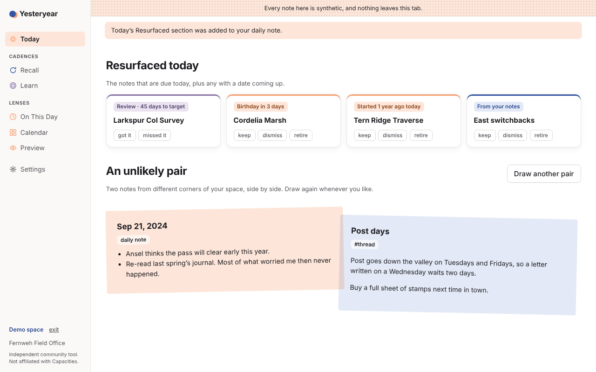
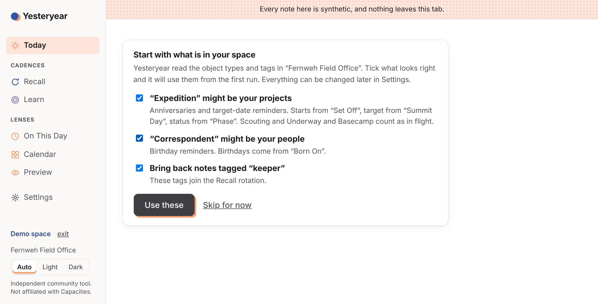
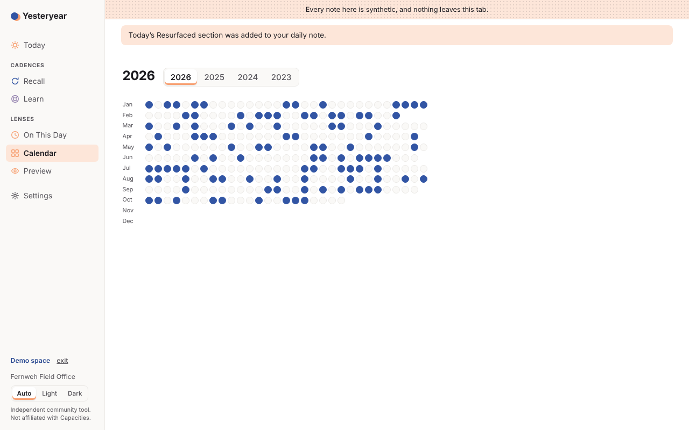

# Yesteryear

[](https://github.com/saj-sudo/yesteryear/actions/workflows/ci.yml)

**Your older Capacities notes, back on a schedule.**



> **Disclaimer:** Yesteryear is an independent community tool. It is not
> affiliated with, endorsed by, or sponsored by Capacities. Capacities is a
> trademark of its respective owners.

Notes go into Capacities easily and rarely come back out. Yesteryear reads your space and shows your own past notes again, on the site and, if you turn it on, as a short `Resurfaced` section in the daily note you open each morning.

- Notes you tag as worth seeing again return when they are due, a month or six months later.
- Notes tied to a real date, like a talk or an exam, return more often as it gets closer.
- Each day you also get one unlikely pair: two notes from different corners of your space, side by side.
- Date views are extra ways to look back: on this day across the years, birthdays and project dates.

The daily mix draws partly at random, because a calendar can only bring back notes that already share a date.

## No server and no tracking

Yesteryear is static files. OAuth runs in your browser, tokens stay in your browser, and every API call goes from your browser to `api.capacities.io`. No note content passes through a server the maintainer runs, because there is none, and there are no accounts or analytics.

A token kept in a browser can be read by any script on the page. For that reason the app bundles everything, loads no third-party scripts, and sends a strict Content-Security-Policy that [a test](tests/build/csp.test.ts) checks.

The runtime dependencies are `preact`, the official `@capacities/api` SDK, and its `zod` peer. Browser storage is no OS keychain, so you can revoke access any time under **Settings → Capacities API → Connections**.

Your resurfacing history lives in a `Yesteryear State` page inside your own space. You can read it, export it as JSON from Settings, or delete it to start over. Clearing browser data only signs you out, because the history was never stored only in the browser.

## Works with your object types

No type ID, property ID or tag name is hardcoded. Yesteryear reads what your space contains, and you map it in Settings:

- which type holds projects, and which holds people
- which date property is a birthday
- which tags mark a note worth seeing again
- which status values mean a project is active
- whether whole pages or single paragraphs come back

On your first visit, Yesteryear reads your types, date and status properties and tags, and offers what it found, such as "Your projects are Project" or "Birthdays come from Birthday". Names it recognises start ticked, and a guess from the shape of a type says so and starts unticked. Nothing changes without a tick, and anything you have already mapped is left alone.

Anything you don't map is skipped. A space with nothing set up still gets On This Day, because every space has daily notes. If a name in your settings is missing from your space, the error says what was missing and lists what your space has.

## What you need in Capacities

Nothing. Daily notes alone are enough to start, and every space has them. A few things in your space make it do more:

- **Projects with dates** bring anniversaries and target-date reminders. In Capacities, open **Settings → Object Types**, choose **+ New Type**, and pick a prebuilt type such as Project, or create your own.
- **People with a birthday** bring birthday reminders. A type with a date property for the birthday is enough.
- **Tags** mark the notes worth seeing again. Tag a note in Capacities and it appears under Recall.
- **A type with no date?** Open the type's settings, choose **Add property**, and add a date.

## Getting started

1. Open the site and click **Connect to Capacities**, or **Try the demo** first. The demo runs on a made-up space and needs no account.
2. Approve access and pick which space to share. That choice happens on the Capacities side.
3. The first time, you see what Yesteryear found in your space and tick what looks right. Then you land on **Today**: the day's resurfaced notes, with an unlikely pair underneath. It works with no setup, because daily notes alone are enough.


4. Each schedule has its own page: **Recall** helps you pick resurfacing tags, and **Learn** turns on with one click and holds your study sets. **Settings** holds the full mapping.
5. Open **Preview** to see what tomorrow would bring back, before anything is written.
6. If you like it, turn on the daily note section. On your first visit each day, a `Resurfaced` section is added to that day's note.

On a phone you can add the site to your home screen so it opens on Today. A switch in the sidebar (at the bottom of the page on a phone) sets light, dark or automatic.

### Use it now with a personal token

One-click connect needs an OAuth client id from Capacities. Until that is in place, or for your own self-hosted build, use a personal token.

1. In the Capacities desktop app, create a token under **Settings → Capacities API → API Tokens** for the space you want to use, with read and write access.
2. Run the site (`npm install && npm run dev`) and paste the token under **Advanced** on the Connect screen.
3. The token stays in your browser's storage, so treat it like a password. You can revoke it in the same settings screen at any time.

## Answering is optional

You answer in the note itself, and not answering is always fine: the note stays on its normal schedule.

- Tick the box (or strike `keep`) to keep a note in rotation.
- Strike `dismiss` to see it three times less often.
- Strike `retire` to never see it again.

Nothing is removed unless you retire it, and you can edit or delete the whole section. The parser accepts hand-edited notes.

## The two schedules

### Recall (the default)

Recall is the general schedule. Personal notes have no deadline, so there is no memory schedule to optimise. It uses:

- a 45-day cooldown between showings of a note
- weighted sampling that favours tag groups and notes you haven't seen in a while
- a fixed 20% share of pure chance

Recall gets at least half of each day's slots. Items tied to a date that matters (birthdays, target dates) always appear, and same-day lookbacks share what is left. The pair on Today sits next to the schedule and never changes it.

### Learn (opt-in)

Learn is for the few notes you want to know well before a known date, like a talk or an exam. Notes go into **study sets**. A set has a name, one date, and the notes in it, chosen by tag, by object type, or one by one with a search.

- The date belongs to the set, so you set it once, and changing it moves every note in the set.
- A note in two sets studies toward the nearer date, then the next.
- The gap between reviews is 0.15 times the days remaining, with limits, so reviews come closer together as the date gets near. The first review is always delayed a little.
- When a date passes, the set's notes leave Learn and go back to Recall if they carry a Recall tag. Give the set a new date and the same notes study again, which suits an exam you sit more than once.
- **Show notes** on a set lists what it holds right now, and each note in Learn names the set it studies toward.
- A note can also take its own date from a date property, or be flagged from the Recall page with a date of its own.

Learn stays small: no cloze deletions and no grading ladders. For real memorisation, use [Anki](https://apps.ankiweb.net/). Learn exists for notes you already have, because moving notes into Anki is a chore of its own.

There are no streaks, counters or reminders anywhere. Leaving everything untouched is a normal state.



## Built on the official API

Yesteryear uses the official Capacities HTTP API through the official [`@capacities/api`](https://www.npmjs.com/package/@capacities/api) TypeScript SDK, and no internal interfaces of the app, which some community tools depend on. OAuth 2.1 with PKCE is the main sign-in, and the personal token path is for self-hosters and early testing. Using only the official API keeps Yesteryear working as Capacities changes.

## Deploying your own

The site works on any static host, with no server functions.

```sh
npm install
VITE_CAPACITIES_CLIENT_ID=<your client id> npm run build   # output in dist/
```

- The OAuth `client_id` comes from Capacities. Registration is [by email](https://developers.capacities.io), and you register your own `/callback` URL as the redirect URI.
- The id is public by design (a PKCE public client has no client secret). Without one, the site still serves the demo.
- On Cloudflare Workers, the `wrangler.jsonc` in the repo serves `dist/` as static assets.
- Link previews use absolute URLs. Change `og:image` and `og:url` in `index.html` to your own domain.

## Development

```sh
npm install
npm run lint    # eslint, warnings fail
npm test        # Vitest; the whole engine runs against made-up fixture spaces
npm run dev     # local dev server
npm run build   # typecheck + production build
npm run smoke   # after a build: every page and demo view in Chromium
```

The engine (`src/engine/`) is plain TypeScript with no Capacities or DOM imports. Providers implement a small interface, which would also make an adapter for another notes app possible. See [CONTRIBUTING.md](CONTRIBUTING.md), including the writing rules.

## License

[MIT](LICENSE)
